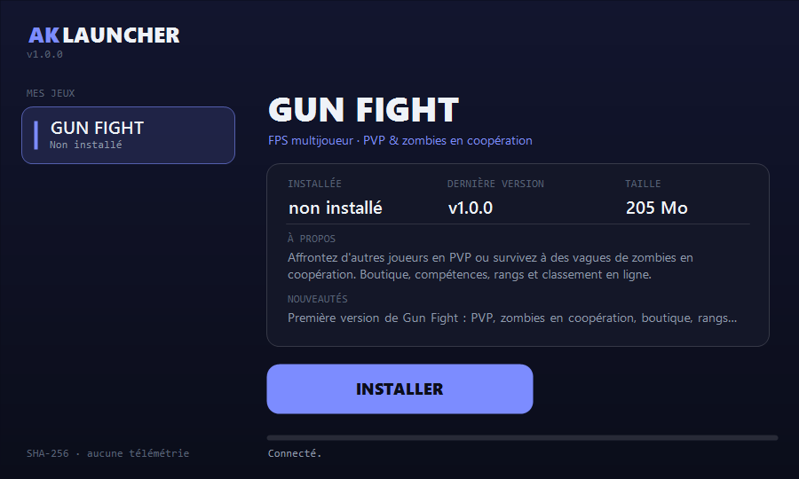

<div align="center">

# AK Launcher

**Installez et mettez à jour mes jeux en un clic.**

[](https://github.com/AikoDevHs/ak-launcher/releases/download/launcher-v1.0.0/AKLauncher.exe)




</div>

---

## Pourquoi ce launcher ?

Plutôt que de renvoyer un gros fichier à chaque mise à jour, **AK Launcher** garde mes jeux à jour pour vous :
il regarde s'il existe une nouvelle version, ne télécharge **que ce qui a changé**, vérifie les fichiers, puis vous laisse jouer.

- **Un clic** pour installer, mettre à jour ou lancer un jeu.
- **Léger** : le launcher fait environ 26 Ko, sans installation.
- **Transparent** : le code tient dans un seul fichier que vous pouvez lire.
- **Respectueux** : pas de compte, pas de publicité, pas de télémétrie.

## Installation

1. Téléchargez [**AKLauncher.exe**](https://github.com/AikoDevHs/ak-launcher/releases/download/launcher-v1.0.0/AKLauncher.exe) (ou rendez-vous sur la page [Releases](../../releases)).
2. Lancez-le.
3. Choisissez un jeu dans la liste de gauche, puis cliquez sur **INSTALLER**.
4. Quand une nouvelle version sort, le bouton devient **METTRE À JOUR**. Un clic, et c'est fait.

Aucun droit administrateur n'est nécessaire.

> **Windows affiche « Windows a protégé votre ordinateur » ?**
> C'est normal pour un petit programme qui n'est pas signé : un certificat de signature de code est payant.
> Cliquez sur **Informations complémentaires**, puis **Exécuter quand même**.
> Si vous préférez ne pas me croire sur parole, vous pouvez [vérifier le fichier](#vérifier-votre-téléchargement) ou [le compiler vous-même](#compiler-vous-même).

## Jeux disponibles

| Jeu | Description |
|---|---|
| **GUN FIGHT** | FPS multijoueur : PVP et zombies en coopération, boutique, compétences, rangs et classement en ligne. |

D'autres jeux arriveront ici. Ils apparaîtront automatiquement dans le launcher, sans rien réinstaller.

## Votre confiance, en toute transparence

Voici exactement ce que fait le launcher, et ce qu'il ne fait pas.

| | |
|---|---|
| **Ce qu'il télécharge** | La liste des jeux (`games.json`), puis les fichiers du jeu que vous choisissez, depuis GitHub, en HTTPS. |
| **Vérification** | Chaque fichier est contrôlé par son empreinte **SHA-256** avant d'être installé. S'il est corrompu, il est rejeté et rien n'est modifié. |
| **Où ça s'installe** | Dans `%LOCALAPPDATA%\AKLauncher\`, c'est-à-dire votre profil utilisateur. Rien d'autre sur le PC. |
| **Droits** | Aucun droit administrateur, aucune modification du registre. |
| **Réseau** | Uniquement GitHub. Une adresse qui ne commence pas par `https://github.com/` est refusée. |
| **Données personnelles** | Aucun compte, aucune télémétrie, aucune publicité. Comme pour tout téléchargement, GitHub voit votre adresse IP. |
| **Hors ligne** | Les jeux déjà installés restent lançables sans connexion. |
| **Désinstaller** | Bouton **Désinstaller** dans le launcher, ou suppression du dossier `%LOCALAPPDATA%\AKLauncher`. |

**Limite à connaître :** le SHA-256 protège contre un téléchargement abîmé, pas contre un dépôt compromis, car les empreintes sont publiées dans ce même dépôt.
C'est pourquoi le code est ouvert : vous pouvez tout contrôler.

## Vérifier votre téléchargement

Chaque release du launcher indique le **SHA-256** de `AKLauncher.exe`. Dans PowerShell, dans le dossier du fichier :

```powershell
Get-FileHash .\AKLauncher.exe -Algorithm SHA256
```

Le résultat doit être **identique** à celui affiché sur la page de la release. S'il est différent, ne lancez pas le fichier.

## Compiler vous-même

Tout le launcher est dans un seul fichier : [`src/AKLauncher/Program.cs`](src/AKLauncher/Program.cs) (environ 600 lignes de C#, aucune dépendance).

```powershell
powershell -ExecutionPolicy Bypass -File build.ps1
```

Le résultat est `dist\AKLauncher.exe`, compilé avec le compilateur fourni par Windows (.NET Framework 4, présent sur Windows 10 et 11). Aucun outil à installer.

## Questions fréquentes

**Où sont installés mes jeux ?**
Dans `%LOCALAPPDATA%\AKLauncher\games\<nom du jeu>\`. Collez ce chemin dans l'explorateur de fichiers pour l'ouvrir.

**Le launcher dit « Impossible de joindre le serveur ».**
Vérifiez votre connexion Internet, puis cliquez sur **RÉESSAYER**. Si le jeu est déjà installé, vous pouvez le lancer hors ligne.

**« Fermez le jeu avant de continuer ».**
Une mise à jour ne peut pas remplacer un jeu en cours d'exécution. Quittez-le, puis recommencez.

**Un jeu ne se lance plus après une mise à jour.**
Cliquez sur **Vérifier / réparer** : le launcher recontrôle chaque fichier et retélécharge ceux qui sont abîmés.

**Comment tout supprimer ?**
Supprimez le dossier `%LOCALAPPDATA%\AKLauncher` puis `AKLauncher.exe`. Il ne reste rien d'autre.

## Pour le développeur

Publier un jeu, mettre à jour le launcher ou ajouter un nouveau jeu : voir [`docs/PUBLISHING.md`](docs/PUBLISHING.md).

```
src/AKLauncher/   code du launcher (C#)
games/            description de chaque jeu (nom, fichiers, build)
tools/            scripts de publication
docs/             documentation et capture d'écran
build.ps1         compile le launcher
```

## Licence

Le launcher est sous licence [MIT](LICENSE). Les jeux distribués ont chacun leur propre licence.
