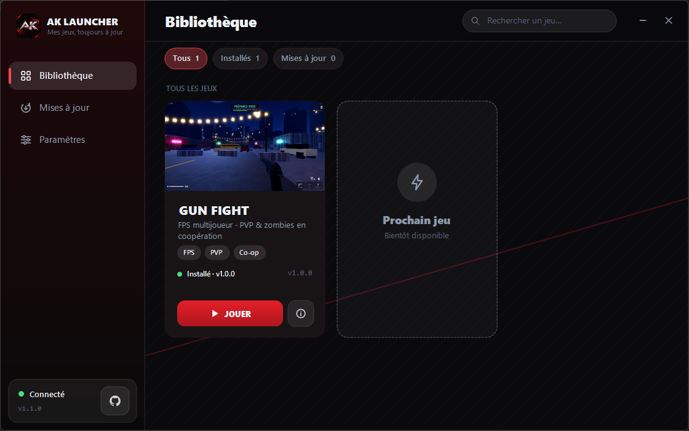

<div align="center">

# AK Launcher

### Installez et mettez à jour mes jeux en un clic.

[](https://github.com/AikoDevHs/ak-launcher/releases/download/launcher-v1.1.2/AKLauncher.exe)




</div>

<br>

## ✨ En bref

|  |  |
|---|---|
| ⚡ **Un clic** | Installer, mettre à jour et lancer un jeu depuis la même fenêtre. |
| 🪶 **Ultra léger** | Le launcher pèse moins de 500 Ko. Il n'y a rien à installer. |
| 🔄 **Toujours à jour** | Il détecte les nouvelles versions et ne télécharge que ce qui a changé. |
| 🔒 **Sûr** | Chaque fichier est vérifié avant d'être installé. Aucun compte, aucune télémétrie. |

<br>

## 🚀 Installation

1. **Téléchargez** [`AKLauncher.exe`](https://github.com/AikoDevHs/ak-launcher/releases/download/launcher-v1.1.2/AKLauncher.exe).
2. **Lancez-le** : aucun droit administrateur n'est demandé.
3. **Choisissez un jeu** et cliquez sur **INSTALLER**. Quand une mise à jour sort, le bouton devient **METTRE À JOUR**.

> **Windows affiche « Windows a protégé votre ordinateur » ?**
> C'est normal pour un petit programme non signé (la signature de code est payante).
> Cliquez sur **Informations complémentaires**, puis sur **Exécuter quand même**.
> Vous pouvez aussi [vérifier le fichier](#-vérifier-votre-téléchargement) ou l'analyser avec Windows Defender avant de le lancer.

<br>

## 🛡️ Pourquoi vous pouvez lui faire confiance

| | |
|---|---|
| **Transparent** | Le launcher fait ce qui est décrit sur cette page, et rien d'autre : il télécharge des jeux, les vérifie et les lance. |
| **Fichiers vérifiés** | Chaque fichier téléchargé est contrôlé par son empreinte **SHA-256**. S'il est abîmé, il est rejeté et rien n'est modifié. |
| **Installé chez vous, rien d'autre** | Dans `%LOCALAPPDATA%\AKLauncher`, c'est-à-dire votre profil. Pas de droits administrateur, pas de modification du système. |
| **Uniquement GitHub** | Le launcher ne contacte que GitHub, en HTTPS. Toute autre adresse est refusée. |
| **Discret** | Aucun compte, aucune publicité, aucune télémétrie. Comme tout téléchargement, GitHub voit votre adresse IP. |
| **Réversible** | Bouton **Désinstaller** dans le launcher, ou supprimez simplement le dossier `%LOCALAPPDATA%\AKLauncher`. |
| **Hors ligne** | Les jeux déjà installés se lancent sans connexion. |

> La vérification SHA-256 protège contre un téléchargement corrompu ou incomplet. Les empreintes sont publiées sur ce dépôt GitHub, que vous pouvez consulter à tout moment.

<br>

## 🔍 Vérifier votre téléchargement

Chaque version du launcher indique son **SHA-256** dans la description de la release. Dans PowerShell, depuis le dossier du fichier :

```powershell
Get-FileHash .\AKLauncher.exe -Algorithm SHA256
```

Le résultat doit être **identique** à celui affiché sur la page de la release. Sinon, ne lancez pas le fichier.

<br>

## ❓ Questions fréquentes

<details>
<summary><b>Où sont installés mes jeux ?</b></summary>

Dans `%LOCALAPPDATA%\AKLauncher\games\`. Collez ce chemin dans l'explorateur de fichiers pour l'ouvrir, ou utilisez le bouton « dossier » de la page du jeu.
</details>

<details>
<summary><b>« Impossible de joindre le serveur »</b></summary>

Vérifiez votre connexion Internet. Si le jeu est déjà installé, vous pouvez le lancer hors ligne.
</details>

<details>
<summary><b>« Fermez le jeu avant de continuer »</b></summary>

Une mise à jour ne peut pas remplacer un jeu en cours d'exécution. Quittez-le, puis recommencez.
</details>

<details>
<summary><b>Un jeu ne se lance plus après une mise à jour</b></summary>

Ouvrez la page du jeu et cliquez sur le bouton **Vérifier / réparer** : le launcher recontrôle chaque fichier et retélécharge ceux qui sont abîmés.
</details>

<details>
<summary><b>Comment tout supprimer ?</b></summary>

Supprimez le dossier `%LOCALAPPDATA%\AKLauncher`, puis `AKLauncher.exe`. Il ne reste rien d'autre.
</details>

<br>

---

<div align="center">

© 2026 AikoDevHs · Tous droits réservés. AK Launcher est gratuit pour un usage personnel ; son code source est privé.<br>
Fait avec ❤️ par [AikoDevHs](https://github.com/AikoDevHs)

</div>
