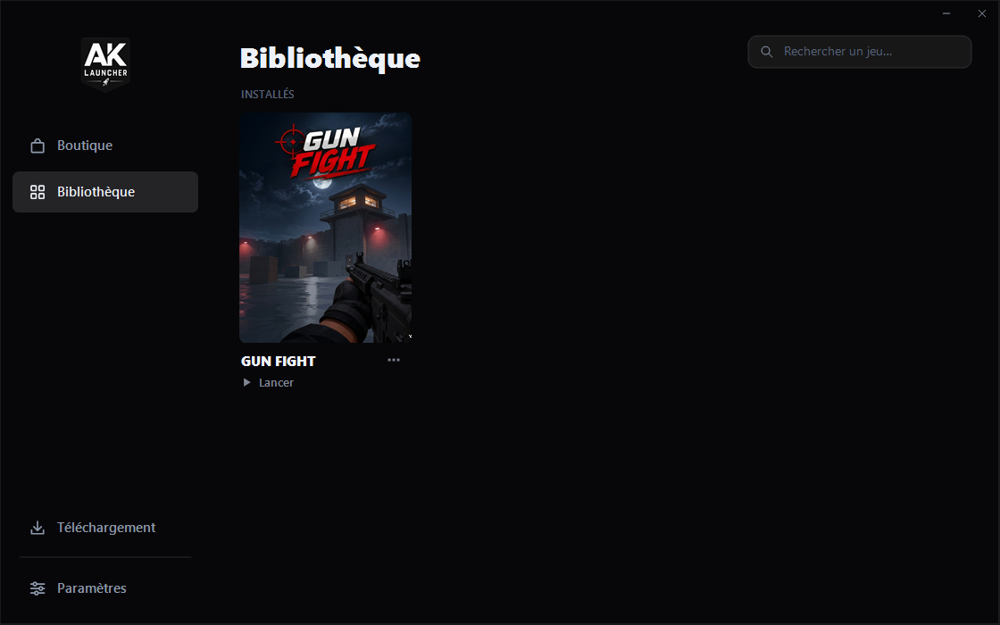
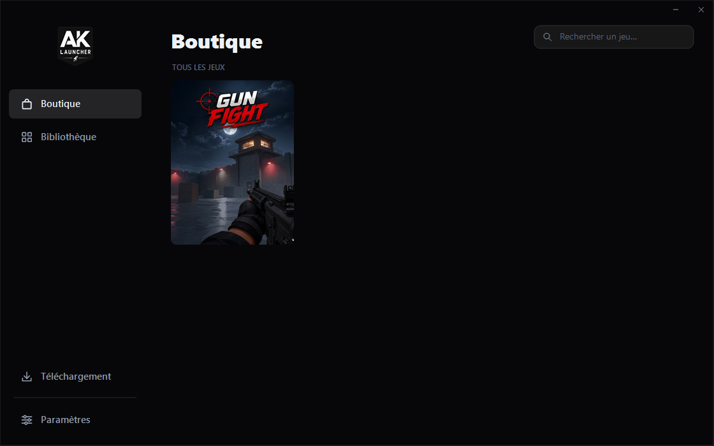
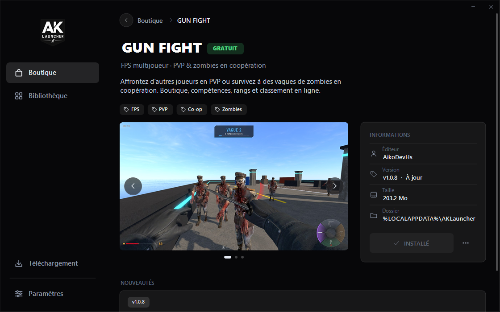

<div align="center">

# AK Launcher

### Installez et lancez mes jeux en un clic.

[**⬇ Télécharger AK Launcher**](https://github.com/AikoDevHs/ak-launcher/releases/download/launcher-v1.1.8/AK-Launcher.exe)




</div>

<br>

## 🚀 Comment ça marche

1. **Téléchargez** [`AK-Launcher.exe`](https://github.com/AikoDevHs/ak-launcher/releases/download/launcher-v1.1.8/AK-Launcher.exe) et **lancez-le**. Rien à installer, aucun droit administrateur.
2. Ouvrez la **Boutique**, choisissez un jeu et cliquez sur **Installer**. Suivez le téléchargement dans **Téléchargement**.
3. Le jeu apparaît dans votre **Bibliothèque** : cliquez dessus (ou sur **Lancer**) pour jouer.

> **Windows affiche « Windows a protégé votre ordinateur » ?** C'est normal pour un petit programme non signé.
> Cliquez sur **Informations complémentaires**, puis **Exécuter quand même**.

<br>

## 🖼️ Aperçu

<table>
<tr>
<td width="50%"><br><sub><b>La Boutique</b> : tous les jeux disponibles.</sub></td>
<td width="50%"><br><sub><b>La page d'un jeu</b> : description, captures, installation.</sub></td>
</tr>
</table>

<br>

## 🔄 Toujours à jour

- **Le launcher se met à jour tout seul** à chaque démarrage, sans rien faire.
- **Les jeux** : quand une nouvelle version sort, elle apparaît dans **Téléchargement**. Seuls les fichiers modifiés sont téléchargés.

<br>

## 🛡️ En toute confiance

- Aucun compte, aucune publicité, **aucune télémétrie**.
- Tout est installé dans votre profil (`%LOCALAPPDATA%\AKLauncher`), sans modifier le système.
- Le launcher ne contacte que **GitHub**, en HTTPS. Chaque fichier est vérifié par son empreinte **SHA-256** avant d'être installé.
- Pour tout supprimer : **Désinstaller** dans le menu **⋯** d'un jeu, puis supprimez le dossier ci-dessus et `AK-Launcher.exe`.

<details>
<summary><b>Vérifier mon téléchargement</b></summary>

<br>

Chaque version indique son **SHA-256** dans la description de sa [release](https://github.com/AikoDevHs/ak-launcher/releases). Dans PowerShell, depuis le dossier du fichier :

```powershell
Get-FileHash .\AK-Launcher.exe -Algorithm SHA256
```

Le résultat doit être identique à celui de la release. Sinon, ne lancez pas le fichier.
</details>

<br>

## ❓ Questions fréquentes

<details>
<summary><b>« Impossible de joindre le serveur »</b></summary>

Vérifiez votre connexion Internet. Les jeux déjà installés se lancent sans connexion.
</details>

<details>
<summary><b>« Fermez le jeu avant de continuer »</b></summary>

Une mise à jour ne peut pas remplacer un jeu en cours d'exécution. Quittez-le, puis recommencez.
</details>

<details>
<summary><b>Un jeu ne se lance plus</b></summary>

Dans la **Bibliothèque**, ouvrez le menu **⋯** du jeu puis **Réparer les fichiers** : le launcher recontrôle chaque fichier et retélécharge ceux qui sont abîmés.
</details>

<br>

---

<div align="center">

© 2026 [AikoDevHs](https://github.com/AikoDevHs) · Tous droits réservés.

</div>
